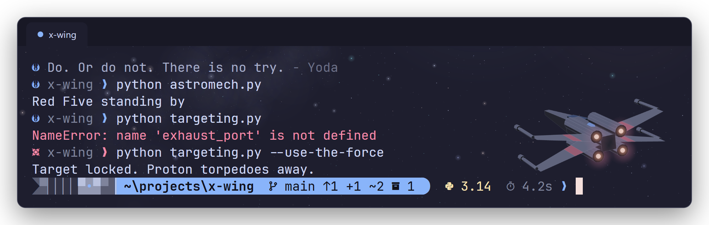
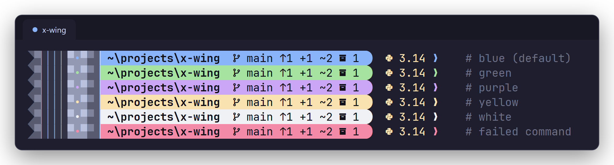

# star-wars-terminal

A Jedi-themed terminal for Windows, macOS and Linux, installed with one command.

Your prompt becomes a lightsaber: a metal hilt with a status light, and a glowing blade that holds your path and git status. Language versions sit beside it, and the colors come from [Catppuccin Mocha](https://catppuccin.com). Behind it all is a starfield with an X-wing heading into the galaxy.



## Install

**Windows** (PowerShell):

```powershell
irm https://raw.githubusercontent.com/bhargavCSSE/star-wars-terminal/master/install.ps1 | iex
```

**macOS and Linux**:

```sh
curl -fsSL https://raw.githubusercontent.com/bhargavCSSE/star-wars-terminal/master/install.sh | bash
```

Then open a new terminal window.

## What you get

- **Lightsaber prompt.** Your path and git branch sit inside the blade, with counts of staged and unstaged changes, ahead/behind, and stashes.
- **Status at a glance.** The blade turns red after a failed command. Admin and root shells get a black Darksaber.
- **Language versions, only when relevant.** Python (with the active virtual environment), Node, Rust, Go, Java and .NET appear only inside projects that use them.
- **Run time** for commands that take longer than 2 seconds.
- **Clean scrollback.** Earlier prompts collapse to a small crest, the folder name and `❯`.
- **A line from the Jedi Archives** each time you open a terminal.
- **Your choice of saber color.** See below.

## Choose your lightsaber



```sh
saber green     # Luke, Yoda, Qui-Gon
saber purple    # Mace Windu
saber yellow    # Rey, Temple Guards
saber white     # Ahsoka
saber blue      # Obi-Wan, Anakin (the default)
saber           # show the current color
```

The color changes right away, and every shell remembers it. Red isn't offered, because it's reserved for failed commands.

## What the installer changes

1. Installs [Oh My Posh](https://ohmyposh.dev) and [JetBrainsMono Nerd Font](https://www.nerdfonts.com) if you don't have them. It uses winget on Windows and Homebrew on macOS, with the official downloads as a fallback.
2. Copies the theme to `~/.config/star-wars-terminal`.
3. Adds a short, clearly marked block to your shell startup files:
   - PowerShell's all-hosts `profile.ps1`
   - `~/.bashrc`, `~/.zshrc` and `~/.bash_profile` (macOS)
   - fish's `conf.d`
   - Clink, for Command Prompt
4. Themes the terminals it finds: Windows Terminal, iTerm2, kitty and the VS Code terminal.

Every settings file it edits is backed up first, next to the original, as `*.swt-backup-<date>`. Running the installer again is safe: it updates the files and doesn't add duplicate blocks.

On Windows, if PowerShell's execution policy blocks profile scripts, the installer sets it to `RemoteSigned` for your user. This is the setting Oh My Posh recommends.

## Supported shells and terminals

| Shell | |
|---|---|
| PowerShell 7 (Windows, macOS, Linux) and Windows PowerShell 5.1 | ✅ |
| bash, zsh | ✅ |
| fish | ✅ |
| Command Prompt | ✅ with [Clink](https://chrisant996.github.io/clink/) (the installer hooks it in if Clink is installed, or add `-WithClink`) |

| Terminal | Colors and font | Starfield background |
|---|---|---|
| Windows Terminal | ✅ automatic | ✅ |
| VS Code (all platforms) | ✅ automatic | VS Code can't show background images |
| iTerm2 | ✅ adds a **Star Wars** profile (set it as default in Settings → Profiles) | ✅ |
| kitty | ✅ automatic | ✅ |
| WezTerm | paste [`terminals/wezterm.lua`](terminals/wezterm.lua) into your config | ✅ |
| Alacritty | import [`terminals/alacritty.toml`](terminals/alacritty.toml) | Alacritty can't show background images |
| Ptyxis and GNOME Terminal (the defaults on Fedora, Ubuntu and other GNOME desktops) | set the font to **JetBrainsMono Nerd Font Mono** and pick Catppuccin Mocha colors | they can't show background images; use kitty for the starfield |
| Others (Terminal.app, Konsole, …) | set the font to **JetBrainsMono Nerd Font Mono** and pick Catppuccin Mocha colors | depends on the terminal |

## Uninstall

**Windows:**

```powershell
& ([scriptblock]::Create((irm https://raw.githubusercontent.com/bhargavCSSE/star-wars-terminal/master/install.ps1))) -Uninstall
```

**macOS and Linux:**

```sh
curl -fsSL https://raw.githubusercontent.com/bhargavCSSE/star-wars-terminal/master/install.sh | bash -s -- --uninstall
```

Uninstalling removes the shell blocks, the theme folder, the iTerm2 profile, the kitty theme and the Windows Terminal background. It keeps Oh My Posh, the font and your terminal colors. The backups of every edited file are still there if you want your old settings back.

## Install from a clone

```sh
git clone https://github.com/bhargavCSSE/star-wars-terminal.git
cd star-wars-terminal
bash install.sh             # macOS / Linux
.\install.ps1               # Windows
```

Options:
- **Skip installing dependencies:** `--skip-deps` (`-SkipDependencies` on Windows).
- **Uninstall:** `--uninstall` (`-Uninstall` on Windows).
- **Also install Clink so Command Prompt gets the prompt:** `-WithClink` (Windows).

## Customize

| What | Where |
|---|---|
| Prompt layout and colors | `theme/jedi.omp.json` ([Oh My Posh docs](https://ohmyposh.dev/docs)) |
| Jedi quotes | `shell/quotes.txt`, one `Quote\|Speaker` per line |
| Terminal colors | `terminals/` |
| Background | `assets/starfield.png`, painted by `tools/paint-starfield.ps1` (Windows PowerShell). Change the X-wing's angle with `$roll`, `$yaw` and `$pitch`. |

After editing files in your clone, run the installer again to copy them over.

## Troubleshooting

- **Icons show as boxes or `?`.** Your terminal isn't using the Nerd Font. Set it to **JetBrainsMono Nerd Font Mono**. The plain, non-Mono version also works, but the Propo version is meant for apps other than terminals.
- **A small dark wedge at the left end of the prompt.** The hilt's swallowtail notch is drawn in Catppuccin Mocha's background color (`#1E1E2E`). Use that color scheme, or change `void` in `theme/jedi.omp.json` to your background color.
- **No starfield background on Linux.** Your terminal probably can't show images. Fedora's and Ubuntu's default terminals (Ptyxis and GNOME Terminal) can't. Install kitty (`sudo dnf install kitty` or `sudo apt install kitty`), run the installer again, and open kitty.
- **The prompt stays red after pressing Enter on an empty line.** That's expected: no command ran, so the last result was still a failure. It clears after the next successful command.

## Credits

- [Oh My Posh](https://ohmyposh.dev) by Jan De Dobbeleer
- [Nerd Fonts](https://www.nerdfonts.com) and [JetBrains Mono](https://www.jetbrains.com/lp/mono/)
- [Catppuccin](https://catppuccin.com) for the color palette
- [Clink](https://chrisant996.github.io/clink/) for Command Prompt support

Star Wars is a trademark of Lucasfilm Ltd. This is a fan project and isn't affiliated with or endorsed by Lucasfilm or Disney. The background image is original artwork generated by `tools/paint-starfield.ps1`.

## License

[MIT](LICENSE)
